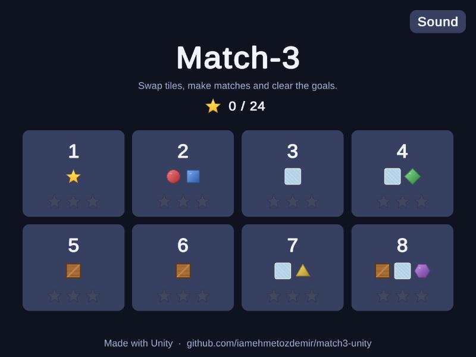
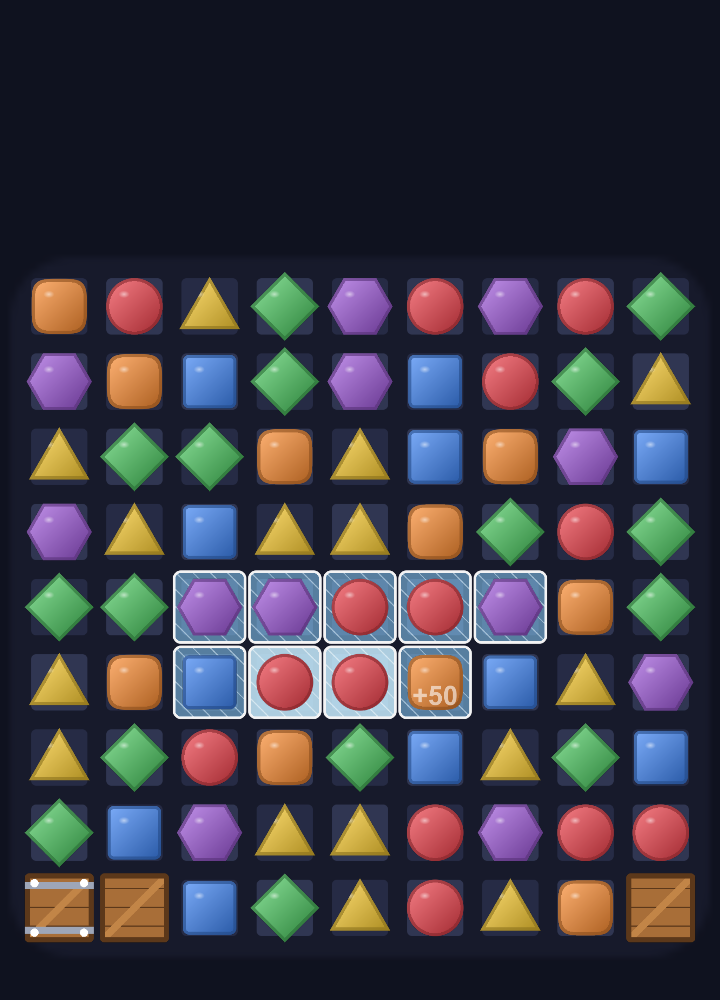

# Match-3 Puzzle (Unity)

[English](#english) · [Türkçe](#türkçe)

**Play in your browser:** https://iamehmetozdemir.github.io/match3-unity/

  
  &nbsp;
  

  
  &nbsp;
  

## English

A match-3 puzzle game I made in Unity 6 with C#. You swap neighbouring tiles to make lines of three or more and finish the level's goals before you run out of moves. There are eight levels.

- **Goals:** reach a score, collect tiles of a color, clear the ice, or break the boxes. Later levels mix them.
- **Obstacles:** ice sits under a tile and cracks when that tile is cleared (some have two layers). Boxes take up a cell, block falling tiles, and break when you match next to them or hit them with a special tile (some need two hits).
- **Special tiles:** 4 in a row makes a rocket (clears a row or column), an L or T shape makes a bomb (3x3 area), 5 in a row makes a color bomb (clears one color). They can trigger each other.
- Chain reactions score more with every step, and a score popup shows how much you got.
- **Boosters** that don't cost a move: a hammer that smashes one tile or hits a box, and a shuffle. One of each per level.
- Menu with level select and 1-3 stars per level (saved on the device), sound effects, hints when you're stuck, and the board shuffles if no move is left.
- No art or audio files: all sprites are drawn in code and all sounds are generated from simple waves. Every color also has its own shape.

### How the code is organized

The game rules live in `Assets/Scripts/Core` and don't use anything from Unity. `MatchEngine.TrySwap` plays out a whole turn at once and returns a plain description of what happened (cleared tiles, cracked ice, damaged boxes, what fell, what was refilled, for each step of the chain). The Unity side (`Assets/Scripts/Game`) just replays that as animation and sound. That made the rules easy to test without opening Unity.

Tiles and particles are reused from a pool instead of being created and destroyed on every match, to avoid garbage collection hitches on phones.

### Tests and level tuning

- 48 unit tests for the rules: matches, every special tile, chains, gravity, ice, boxes (including tiles falling around them), goals, stars, boosters, shuffling.
- 5 Play Mode tests that start the real game, load every level, play 25 turns on the hardest one, use both boosters, and check that what's on screen matches the board.
- The rules tests also run without Unity (`dotnet test Match3.Core.Tests`), and GitHub Actions runs them on every push.

I set the move counts with a small simulator (`Match3.LevelSim`). It plays every level 200 times with a bot that picks random moves and a bot that always picks the move with the most goal progress:

| Level | Goal | Random bot wins | Greedy bot wins |
|---|---|---|---|
| 1 | Score | 67% | 100% |
| 2 | Collect red + blue | 32% | 90% |
| 3 | Ice | 14% | 96% |
| 4 | Ice + collect | 4% | 96% |
| 5 | Boxes | 9% | 84% |
| 6 | Boxes (ring) | 20% | 86% |
| 7 | Ice + collect | 3% | 50% |
| 8 | Boxes + ice + collect | 0% | 51% |

The greedy bot doesn't plan ahead, so a person should do better on the last levels. No one but me has playtested it yet.

### Run it

You need Unity 6 (I used 6000.6.6f1). Add the folder in Unity Hub, open it and press Play. There's no scene to set up, the game starts itself from code. **Match3 → Build WebGL** in the menu makes the browser version.

Controls: drag a tile towards a neighbour, or click two neighbouring tiles.

### Not done / ideas

- The interface uses Unity's IMGUI so the project needs no assets. A uGUI or UI Toolkit version would look more polished.
- No way to earn or buy more boosters.
- I haven't tried it on a phone. Touch should work through Unity's mouse emulation, but I haven't checked.

## Türkçe

Unity 6 ve C# ile yaptığım bir match-3 bulmaca oyunu. Yan yana taşları değiştirip üçlü ya da daha uzun sıralar yapıyorsun ve hamlelerin bitmeden level'ın hedeflerini tamamlaman gerekiyor. Sekiz level var.

- **Hedefler:** skor yapmak, bir renkten taş toplamak, buzu temizlemek ya da kutuları kırmak. Sonraki level'lar bunları karıştırıyor.
- **Engeller:** buz bir taşın altında duruyor ve o taş temizlenince çatlıyor (bazıları iki kat). Kutular bir hücreyi kaplıyor, düşen taşları durduruyor; yanında eşleşme yapınca ya da özel taşla vurunca kırılıyor (bazıları iki vuruş istiyor).
- **Özel taşlar:** 4'lü sıra roket (satır ya da sütunu temizler), L veya T şekli bomba (3x3 alan), 5'li sıra renk bombası (bir rengin hepsini temizler). Birbirlerini tetikleyebiliyorlar.
- Zincirleme patlatmalar her adımda daha çok puan veriyor, kazandığın puan ekranda yazıyor.
- Hamle harcamayan **güçlendiriciler**: bir taşı kıran ya da kutuya vuran çekiç ve karıştırma. Her level'da birer tane.
- Level seçimli menü ve level başına 1-3 yıldız (cihazda kaydediliyor), ses efektleri, takılınca ipucu; hamle kalmazsa tahta karışıyor.
- Hiç görsel ya da ses dosyası yok: tüm sprite'lar kodla çizildi, tüm sesler basit dalgalardan üretiliyor. Her rengin kendi şekli de var.

### Kod nasıl düzenlendi

Oyun kuralları `Assets/Scripts/Core` içinde ve Unity'den hiçbir şey kullanmıyor. `MatchEngine.TrySwap` bir hamlenin hepsini bir anda oynayıp ne olduğunu düz veri olarak veriyor (temizlenen taşlar, çatlayan buz, hasar alan kutular, ne düştü, ne yeniden doldu, zincirin her adımı için). Unity tarafı (`Assets/Scripts/Game`) bunu sadece animasyon ve ses olarak tekrar oynatıyor. Böylece kuralları Unity'yi açmadan test etmek kolay oldu.

Taşlar ve parçacıklar her eşleşmede oluşturulup silinmek yerine bir havuzdan tekrar kullanılıyor; telefonda çöp toplayıcı kaynaklı takılmaları önlemek için.

### Testler ve level ayarı

- Kurallar için 48 birim test: eşleşmeler, her özel taş, zincirler, yerçekimi, buz, kutular (taşların etraflarından düşmesi dahil), hedefler, yıldızlar, güçlendiriciler, karıştırma.
- Gerçek oyunu başlatan, her level'ı yükleyen, en zor level'da 25 hamle oynayan, iki güçlendiriciyi de kullanan ve ekrandakinin tahtayla aynı olduğunu kontrol eden 5 Play Mode testi.
- Kural testleri Unity olmadan da çalışıyor (`dotnet test Match3.Core.Tests`) ve GitHub Actions her push'ta çalıştırıyor.

Hamle sayılarını küçük bir simülatörle (`Match3.LevelSim`) ayarladım. Her level'ı 200 kez rastgele oynayan bir botla ve her zaman hedefe en çok katkı yapan hamleyi seçen bir botla oynatıyor. Sonuçlar yukarıdaki tabloda. Açgözlü bot ileriyi planlamıyor, o yüzden bir insan son level'larda daha iyi yapmalı. Henüz benden başka kimse denemedi.

### Çalıştırma

Unity 6 lazım (ben 6000.6.6f1 kullandım). Klasörü Unity Hub'da ekle, aç ve Play'e bas. Kurulacak sahne yok, oyun kendini koddan başlatıyor. Menüdeki **Match3 → Build WebGL** tarayıcı sürümünü çıkarıyor.

Kontroller: taşı komşusuna doğru sürükle ya da yan yana iki taşa tıkla.

### Yapılmayanlar / fikirler

- Proje hiç dosya gerektirmesin diye arayüz Unity'nin IMGUI'siyle yapıldı. uGUI ya da UI Toolkit ile daha şık olurdu.
- Daha fazla güçlendirici kazanmanın ya da almanın bir yolu yok.
- Telefonda denemedim. Dokunma, Unity'nin fare emülasyonuyla çalışmalı ama kontrol etmedim.
