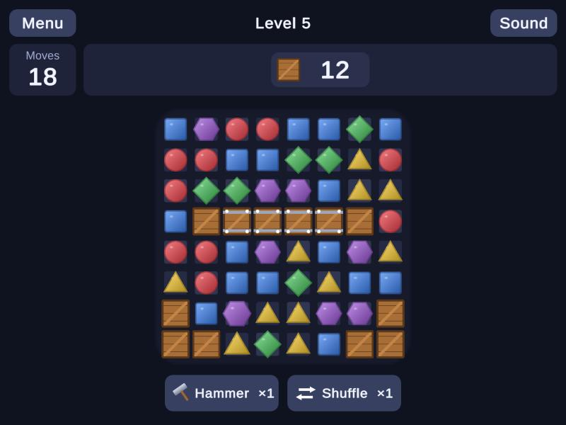
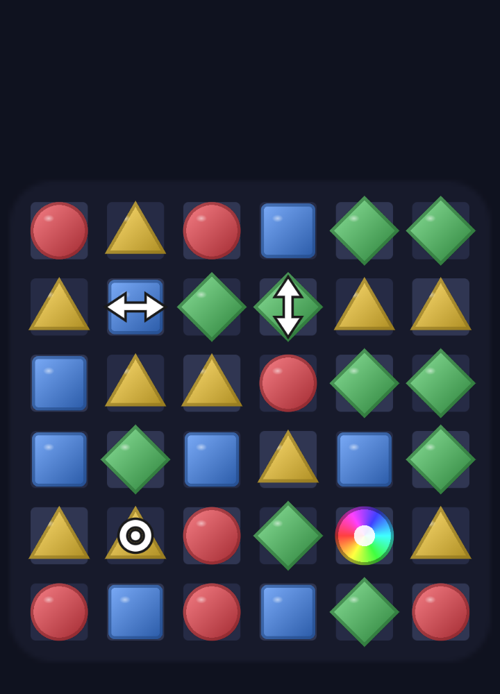

# 🟦 Match-3 Puzzle (Unity)

[🇬🇧 English](#english) · [🇹🇷 Türkçe](#türkçe)

### ▶ [Play it in your browser](https://iamehmetozdemir.github.io/match3-unity/) · [Tarayıcıda oyna](https://iamehmetozdemir.github.io/match3-unity/)

<p align="center">
  
  &nbsp;&nbsp;
  
</p>

---

## English

A small but complete match-3 puzzle game made with Unity 6 and C#: swap neighbouring tiles, make lines of three or more, build special tiles, chain cascades and reach the target score before you run out of moves. Five levels, hints, animations and a win/lose flow are included.

I wanted this to be more than a tutorial clone, so most of the effort went into **how the code is structured** and into **checking that it actually works**, not only into how it looks.

### Features

- Swap by dragging or by tapping two tiles. Works with mouse and touch.
- Matches of 3+, with **cascades** (each chain step scores more).
- **Special tiles** created by bigger matches:

  | Match | Creates | Effect |
  |-------|---------|--------|
  | 4 in a row | Rocket (↔ or ↕) | clears its row or column |
  | L or T shape | Bomb | clears the 3×3 area around it |
  | 5 in a row | Color bomb 🌈 | clears every tile of one color |

  Specials trigger each other (chain reactions), and swapping a color bomb with another tile fires it.
- No dead boards: if no move is left, the board is shuffled.
- Idle hint after a few seconds, five levels with growing boards, move limits and score targets.
- No art files: every sprite is generated in code. Each color also has its own **shape**, so the board is readable for color-blind players.

### How it is built

```
Assets/
├── Scripts/
│   ├── Core/    Match3.Core  – pure C#, no Unity dependency: board, match finding,
│   │                           special tiles, cascades, game session, levels
│   └── Game/    Match3.Game  – Unity layer: sprites, animation, input, HUD
├── Tests/
│   ├── EditMode/  26 NUnit tests for the game logic
│   └── PlayMode/  smoke tests that start the real game and play it
├── Editor/        one-click build script (WebGL / Windows)
└── WebGLTemplates/
Match3.Core.Tests/ runs the same logic tests with plain `dotnet test` (no Unity needed)
```

The key design decision: **the rules live in `Match3.Core` and know nothing about Unity.** `MatchEngine.TrySwap` resolves a whole turn instantly and returns a plain description of what happened (what was cleared, what was created, what fell, what was refilled, per cascade step). The view layer only *replays* that description as animation. That keeps the logic deterministic (seeded random, injectable `IRandom`), unit-testable and easy to change without touching animation code.

### Quality checks

- **26 unit tests** on the game logic: match detection, L/T shapes, every special tile, chain reactions, gravity, cascade scoring, shuffling, win/lose. They run in Unity's Test Runner and also with `dotnet test` in about a second.
- **Property-style tests**: 200 random boards and over a thousand random turns must never leave matches on the board, empty cells or a board without a move.
- **3 Play Mode tests** start the real game, play 25 turns and check that what is on screen always matches the board state.
- **Level balancing by simulation**: a random-move bot and a "greedy" bot (always picks the best immediate move) played every level 300 times. Score targets sit between the two, closer to the greedy bot on later levels. No guessing.

```bash
dotnet test Match3.Core.Tests          # logic tests, no Unity needed
```

### Run it

Requires **Unity 6000.6.6f1** (any Unity 6 version should work).

1. Clone the repo and add the folder in Unity Hub (**Add → Add project from disk**).
2. Open it and press **Play**. The game starts itself from code, so there is no scene to set up.
3. Build with the menu **Match3 → Build WebGL** or **Match3 → Build Windows**. The browser version above is the WebGL build, hosted from the `gh-pages` branch.

Controls: drag a tile towards a neighbour, or tap two neighbouring tiles.

### Known limitations / ideas

- The HUD uses Unity's IMGUI to keep the project asset-free; a uGUI/UI Toolkit version would look more polished.
- Only the score goal exists. Real match-3 games also have collect-goals, obstacles and boosters you can buy.
- No sound yet.
- Uses the old Input Manager (touch is mapped to the mouse), not the new Input System.

---

## Türkçe

Unity 6 ve C# ile yapılmış küçük ama eksiksiz bir match-3 bulmaca oyunu: yan yana taşları kaydır, üçlü ve daha uzun sıralar yap, özel taşlar üret, zincirleme patlatmalar yap ve hamlelerin bitmeden hedef skora ulaş. Beş level, ipucu, animasyonlar ve kazanma/kaybetme akışı var.

Bunun bir eğitim videosu kopyası olmasını istemedim; bu yüzden emeğin çoğunu görünüşten çok **kodun nasıl yapılandırıldığına** ve **gerçekten çalıştığının doğrulanmasına** harcadım.

### Özellikler

- Sürükleyerek ya da iki taşa dokunarak yer değiştirme. Fare ve dokunmatik çalışır.
- 3+ eşleşme ve **zincirleme (cascade)**: her zincir adımı daha çok puan verir.
- Büyük eşleşmelerle oluşan **özel taşlar**:

  | Eşleşme | Oluşan | Etkisi |
  |---------|--------|--------|
  | 4'lü sıra | Roket (↔ veya ↕) | satırını ya da sütununu temizler |
  | L veya T şekli | Bomba | çevresindeki 3×3 alanı temizler |
  | 5'li sıra | Renk bombası 🌈 | bir rengin tüm taşlarını temizler |

  Özel taşlar birbirini tetikler (zincir reaksiyon); renk bombasını başka bir taşla değiştirmek onu patlatır.
- Hamle kalmazsa tahta otomatik karıştırılır.
- Birkaç saniye hareketsizlikte ipucu; büyüyen tahtalar, hamle sınırı ve hedef skorlu beş level.
- Hiç görsel dosya yok: tüm sprite'lar kodla çiziliyor. Her rengin ayrıca kendi **şekli** var, yani renk körleri için de okunaklı.

### Nasıl yapıldı

Klasör yapısı yukarıdaki İngilizce bölümde. Ana tasarım kararı: **kurallar `Match3.Core` içinde ve Unity'yi hiç bilmiyor.** `MatchEngine.TrySwap` bir hamlenin tamamını anında çözer ve olanları düz veri olarak döndürür (ne temizlendi, ne oluştu, ne düştü, ne yeniden doldu, her zincir adımı için). Görüntü katmanı bunu sadece animasyon olarak *tekrar oynatır*. Böylece mantık deterministik (tohumlu rastgelelik, enjekte edilebilir `IRandom`), birim testlenebilir ve animasyon koduna dokunmadan değiştirilebilir.

### Kalite kontrolleri

- Oyun mantığı için **26 birim test**: eşleşme bulma, L/T şekilleri, tüm özel taşlar, zincir reaksiyonlar, yerçekimi, zincir puanlama, karıştırma, kazanma/kaybetme. Unity Test Runner'da ve `dotnet test` ile (yaklaşık bir saniyede) çalışır.
- **Rastgele test**: 200 rastgele tahta ve bin küsur rastgele hamle sonunda tahtada eşleşme, boş hücre ya da hamlesiz durum kalmamalı.
- **3 Play Mode testi** gerçek oyunu başlatır, 25 hamle oynar ve ekrandakinin her zaman tahta durumuyla aynı olduğunu kontrol eder.
- **Simülasyonla level dengesi**: rastgele oynayan bir bot ve her zaman en iyi anlık hamleyi seçen "açgözlü" bir bot her level'ı 300'er kez oynadı. Hedef skorlar ikisinin arasında, sonraki level'larda açgözlü bota yakın. Tahmin yok.

```bash
dotnet test Match3.Core.Tests          # mantık testleri, Unity gerekmez
```

### Çalıştırma

**Unity 6000.6.6f1** gerekir (herhangi bir Unity 6 sürümü çalışmalı).

1. Repoyu klonla, klasörü Unity Hub'da ekle (**Add → Add project from disk**).
2. Aç ve **Play**'e bas. Oyun kendini koddan başlatır, kurulacak sahne yok.
3. **Match3 → Build WebGL** ya da **Match3 → Build Windows** menüsüyle derle. Yukarıdaki tarayıcı sürümü WebGL derlemesi, `gh-pages` branch'inden yayınlanıyor.

Kontroller: taşı komşusuna doğru sürükle ya da yan yana iki taşa dokun.

### Bilinen sınırlar / fikirler

- Projeyi görselsiz tutmak için HUD Unity'nin IMGUI'siyle yapıldı; uGUI/UI Toolkit daha şık olurdu.
- Sadece skor hedefi var. Gerçek match-3 oyunlarında topla-hedefleri, engeller ve satın alınabilen güçlendiriciler de olur.
- Henüz ses yok.
- Yeni Input System değil, eski Input Manager kullanılıyor (dokunma fareye çevrilir).

---

MIT License. Code and generated art by Mehmet Devran Özdemir.
